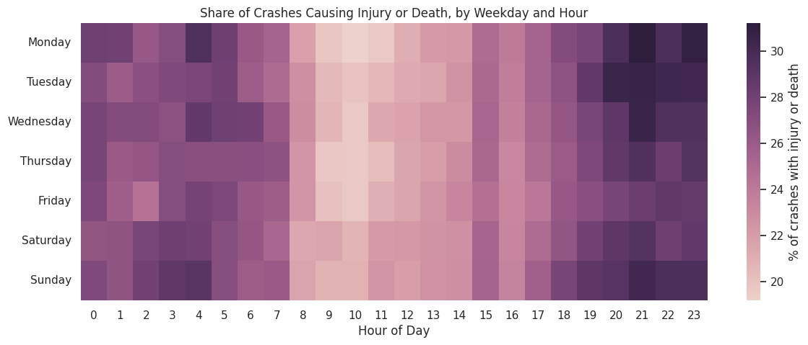

# NYC Crash Severity by Weekday and Hour

Descriptive analysis of NYC motor vehicle collisions for the Transportation Data Science Project (NEBDHub and the National Student Data Corps). No model was built.

**Poster:** `poster.pdf`



## Question

When are NYC crashes most likely to cause harm, not just most common? Crash counts mostly track traffic volume. The share of crashes with an injury or death says more about severity.

## Data

NYC Open Data, [Motor Vehicle Collisions: Crashes](https://data.cityofnewyork.us/Public-Safety/Motor-Vehicle-Collisions-Crashes/h9gi-nx95). Police-reported crashes.

- Records analyzed: 2,268,567, July 1, 2012 to June 7, 2026. The live portal count is higher and grows over time.
- The raw data is not included here. Download it from the link above.

## Method

Milestones 1 to 4 follow the NSDC notebook template. Milestone 5 is my own research question.

1. Loaded the CSV and checked missing values. About 10.6% of crashes have no coordinates.
2. Charted the top contributing factors and vehicle types. Found that the same vehicle type appears under several spellings, such as "Taxi" and "TAXI".
3. Counted crashes by hour of day, by month (including the 2020 COVID drop) and by borough. Decomposed the daily series into trend, seasonal and residual parts.
4. Mapped crash locations with folium: a density heatmap and a severity map. Ranked intersections by crashes, injuries and deaths.
5. Milestone 5: defined a severe crash as at least one person injured or killed. Computed the severe share for each weekday and hour and plotted it as a heatmap.

## Findings

- About 24.7% of all crashes were severe.
- Lowest severe share: 19.2% to 19.7%, on weekdays at 10 and 11 a.m.
- Highest severe share: 30.5% to 31.2%, on Monday to Wednesday evenings, 8 to 11 p.m. Peak: Monday, 9 p.m., 31.2%.
- The gap is about 12 points, roughly 1.6 times.

## Limitations

- Only police-reported crashes appear. Minor crashes may be underreported, possibly differently by hour.
- Weekday and hour are pooled across 14 years. June 2026 is partial.
- Early morning cells rest on fewer crashes.
- The analysis shows when severe crashes are likely, not why. It does not isolate pedestrians or cyclists and has no exposure data such as traffic counts.

## Files

- `Explorer_TDSP_Oluwajoba_Idowu.ipynb`: the full notebook, Milestones 1 to 5, built on the NSDC Explorer template.
- `heatmap.png`: the Milestone 5 figure.
- `poster.pdf`: the Milestone 6 poster.

## Run it

```
pip install pandas numpy matplotlib seaborn statsmodels folium jupyter
jupyter notebook
```

Download the CSV from NYC Open Data. The notebook mounts Google Drive and reads `Motor_Vehicle_Collisions_-_Crashes_20260611.csv` from `MyDrive`, so change the path in the read cell to match where you saved it.

## Author

[YOUR NAME] | Computational Modeling & Data Analytics, Virginia Tech
